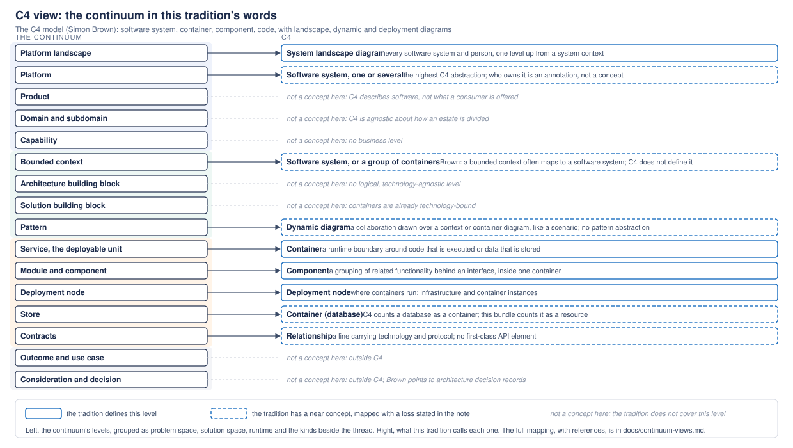
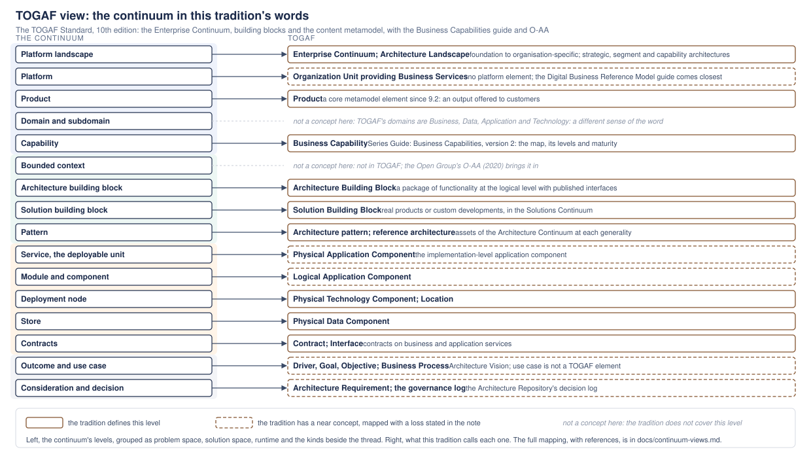
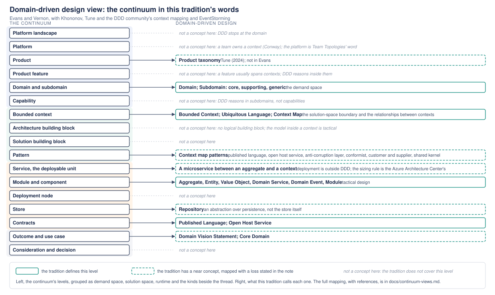
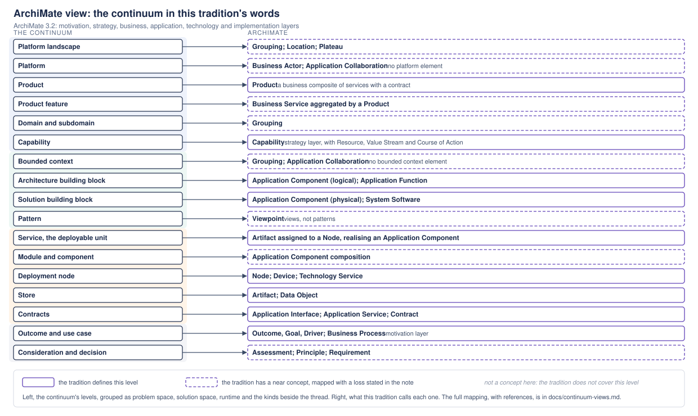
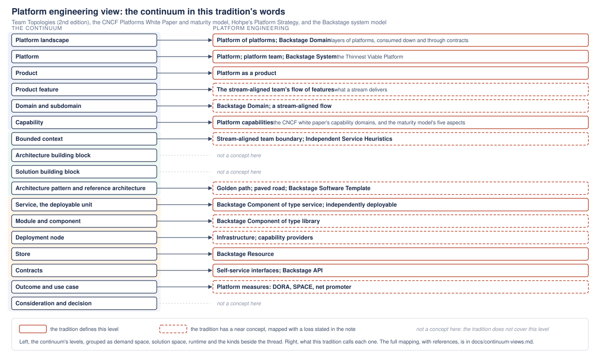
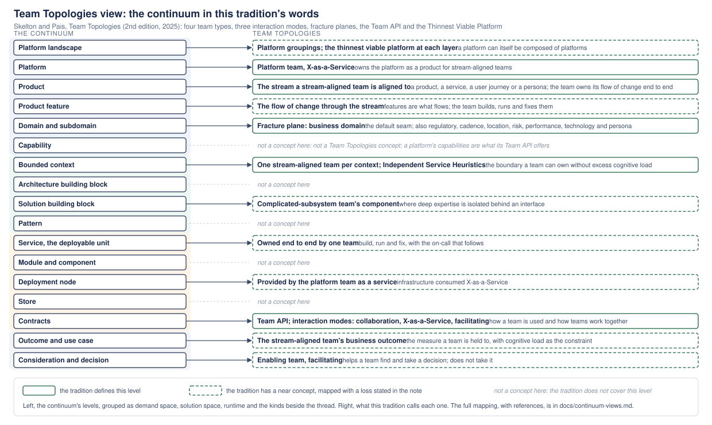
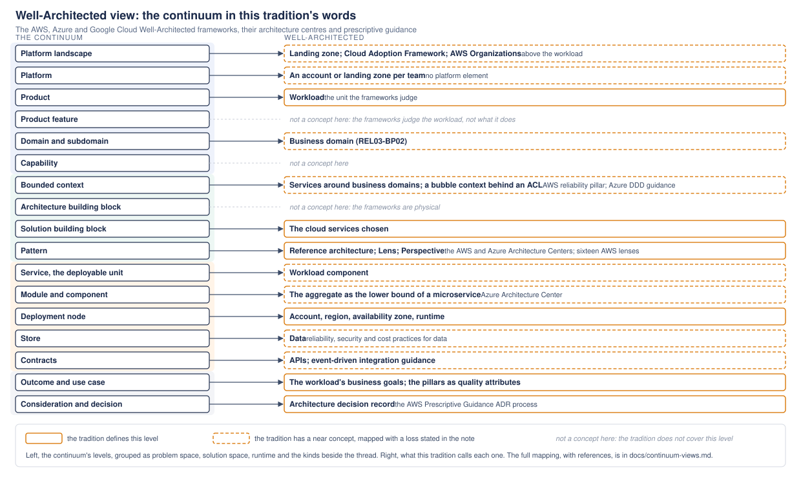

# Views of the continuum

The [continuum](continuum.md) is one vocabulary assembled from several traditions, and each tradition sees only part of it. This page shows the same continuum seven times, once in each tradition's own words: what that tradition calls each level, where it has only a near concept, and where it has none. The point is not to rank the traditions. It is to let an architect who thinks in C4, or TOGAF, or domain-driven design, find their own terms on the continuum and see exactly where the handover to another tradition happens.

Every view uses the same layout. The continuum's levels run down the left, grouped as demand space, solution space, runtime and the kinds beside the thread. The tradition's terms run down the right. A solid box means the tradition defines the level; a dashed box means it has a near concept, mapped with the loss stated in the note; an italic line means the level is not a concept in that tradition. The SVGs are in `views/`, generated from one script so they stay aligned when a level changes.

| View | Sees the continuum as | Strong at | Silent on |
|---|---|---|---|
| [C4](#c4-view) | Software systems, containers, components and code, drawn | Service, module, node, the dynamic view | Everything in the demand space; the logical level |
| [TOGAF](#togaf-view) | Building blocks in a continuum from generic to specific, with a content metamodel | Capability, ABB, SBB, architecture pattern and reference architecture, product, contracts | Bounded context; domain in the DDD sense |
| [Domain-driven design](#domain-driven-design-view) | Domains, subdomains, bounded contexts and the models inside them | Domain, bounded context, contracts, the tactical model | Landscape, platform, capability, the runtime |
| [ArchiMate](#archimate-view) | Layered elements and relationships, modelled | Capability, product, application and technology elements, motivation | Bounded context, architecture pattern and reference architecture |
| [Platform engineering](#platform-engineering-view) | Platforms as products, teams, golden paths and a catalogue | Landscape, platform, product, service, store, contracts | Building blocks, decisions |
| [Team Topologies](#team-topologies-view) | Teams, the streams they own, how they interact, and where to cut | Platform, product and its features, bounded context, contracts as a Team API | Building blocks, patterns, the catalogue |
| [Well-Architected](#well-architected-view) | Workloads judged against pillars, with reference architectures and lenses | Workload, reference architecture, node, decisions | Capability, the logical level |

## C4 view

The C4 model is four abstractions and a handful of diagram types, and it is deliberate about stopping there. A software system is "the highest level of abstraction and describes something that delivers value to its users"; a container is "a runtime boundary around some code that is being executed or some data that is being stored"; a component is "a grouping of related functionality encapsulated behind a well-defined interface"; code is the classes inside. The diagrams are system context, container, component and code, plus the system landscape, dynamic and deployment diagrams.

On the continuum, C4 owns the runtime. The service is the container, the module is the component, and the deployment node is C4's deployment node. The system landscape diagram is the nearest thing to the platform landscape, and a software system is the nearest thing to a platform or a bounded context, but C4 says nothing about who owns a system or where a model's language holds: Brown describes the model as agnostic about how an estate is divided, and notes that a bounded context often ends up as a software system without C4 defining the term. There is no logical, technology-agnostic level, so the architecture building block has no C4 counterpart, and there is no business level, so capability, product and outcome are outside it. The dynamic diagram is the closest thing to a pattern's scenarios, and C4 has no pattern abstraction of its own.

The one place the bundle departs from C4 is the store. C4 counts a database as a container, which is right for a diagram, where a database is a box with technology on it. The bundle records it as a resource of the service that owns it, which is right for a catalogue, where the question is who owns the data and which service may touch it. Backstage draws the same line, component against resource.

References: Simon Brown, the C4 model, [abstractions](https://c4model.com/abstractions) ([software system](https://c4model.com/abstractions/software-system), [container](https://c4model.com/abstractions/container), [component](https://c4model.com/abstractions/component)) and [diagrams](https://c4model.com/diagrams) ([system landscape](https://c4model.com/diagrams/system-landscape), [dynamic](https://c4model.com/diagrams/dynamic), [deployment](https://c4model.com/diagrams/deployment)); Brown's FAQ on [bounded contexts and software systems](https://c4model.com/faq).

## TOGAF view

TOGAF gives the continuum its building blocks and its name. The Enterprise Continuum classifies architecture assets from foundation architectures through common systems and industry architectures to organisation-specific ones, and the Solutions Continuum does the same for the solution building blocks that implement them. The Architecture Landscape is the repository's own architectures at strategic, segment and capability level. The content metamodel defines the elements: business capability (with its own Series Guide, version 2 in 2022), product (a core element since 9.2, an output offered to customers), organisation unit, business service, contract, the logical and physical application, data and technology components, and location. The 10th edition made the standard modular, with the fundamental content and the Series Guides.

On the continuum, TOGAF owns capability, the two building blocks, the architecture pattern and the reference architecture (as assets at each generality), product, contracts, and the technology and data components behind the node and the store. The service and the module map to the physical and logical application component with a loss: TOGAF's components are architecture description, not a unit of release, so independent deployability is not something they say. The platform has no TOGAF element; the organisation unit that provides business services, and the Digital Business Reference Model guide, come closest. Two words clash. TOGAF's domains are the four architecture domains, business, data, application and technology, which is a different sense from DDD's; and TOGAF has no bounded context at all. The Open Group's Open Agile Architecture standard (O-AA, 2020) is where bounded contexts, event storming and product-centric organisation enter Open Group practice, and it is the reason the bundle treats a building block inside a bounded context as a choice within current practice rather than against it.

References: The Open Group, [TOGAF Standard, 10th Edition](https://www.opengroup.org/togaf) (2022): the Architecture Content Framework and content metamodel, the Enterprise Continuum, and the Series Guide: Business Capabilities, version 2; the public [Introduction to Building Blocks](https://pubs.opengroup.org/architecture/togaf7-doc/arch/p4/bbs/bbs_intro.htm), unchanged in substance since; [Open Agile Architecture, O-AA](https://pubs.opengroup.org/architecture/o-aa-standard-single) (2020).

## Domain-driven design view

Domain-driven design gives the continuum its demand space (DDD's demand space) and its solution boundary. A domain is the subject matter; a subdomain is a part of it, core where the business differentiates, supporting where it does not, generic where it buys; a bounded context is the boundary within which one model and one ubiquitous language hold; and the context map names the relationships between contexts: published language, open host service, anti-corruption layer, conformist, customer and supplier, shared kernel, partnership and separate ways. Inside a context, tactical design gives aggregates, entities, value objects, domain services, domain events, repositories and modules.

On the continuum, DDD owns the domain, the bounded context and the contracts between contexts, and its tactical patterns are the module and component level. It is silent above the domain: no landscape, no platform (a team owns a context, which is Conway's law and Team Topologies' territory) and no capability, since DDD reasons in subdomains. Nick Tune's product taxonomy is the recent bridge from subdomains to products. It is also silent on the runtime: deployment is outside DDD, and the rule that a microservice is no smaller than an aggregate and no larger than a bounded context is the Azure Architecture Center's reading, not Evans's. There is no logical building block in DDD, which is why the bundle's rule that an architecture building block lives inside one bounded context is a choice at the intersection of two traditions rather than something either defines. The repository is an abstraction over persistence, not the store itself, so the store maps to it only with that loss.

References: Eric Evans, Domain-Driven Design (2003); Vaughn Vernon, [Implementing Domain-Driven Design](https://www.oreilly.com/library/view/implementing-domain-driven-design/9780133039900/ch02lev1sec5.html) (2013) and Domain-Driven Design Distilled (2016); Vlad Khononov, Learning Domain-Driven Design (2021); Nick Tune and Jean-Georges Perrin, [Architecture Modernization](https://gotopia.tech/books/94/architecture-modernization-socio-technical-alignment-of-software-strategy-and-structure) (2024); Martin Fowler, [BoundedContext](https://martinfowler.com/bliki/BoundedContext.html); the DDD Crew's [context mapping cheat sheet](https://github.com/ddd-crew/context-mapping) and [bounded context canvas](https://github.com/ddd-crew/bounded-context-canvas); Alberto Brandolini, EventStorming; the Azure Architecture Center on [microservice boundaries](https://learn.microsoft.com/en-us/azure/architecture/microservices/model/microservice-boundaries).

## ArchiMate view

ArchiMate is a modelling language, not a method, and it covers more of the continuum than any other single source because it has an element for most things and a relationship for how they join. The motivation layer has stakeholder, driver, assessment, goal, outcome, principle and requirement. The strategy layer has capability, resource, value stream and course of action. The business layer has actor, role, service, process, product and contract. The application layer has component, function, service, interface and data object. The technology layer has node, device, system software, artifact and technology service. The implementation and migration layer has work package, deliverable, plateau and gap, and the composite elements are grouping and location.

On the continuum, ArchiMate owns the outcome, the capability, the product, the two building blocks (as logical and physical application components), the service (an artifact assigned to a node, realising an application component), the node, the store and the contracts. It has no bounded context and no platform: both become a grouping or an application collaboration, which carries the boundary but not the language or the ownership. It has no architecture pattern or reference architecture, only viewpoints, which are views onto a model rather than reusable designs. The assessment and principle elements are the nearest thing to a consideration and a decision. The 3.2 edition (2022) is current.

References: The Open Group, ArchiMate 3.2 Specification (2022); the public [3.1 technology layer](https://pubs.opengroup.org/architecture/archimate31-doc/chap10.html) and [3.0 application layer](https://pubs.opengroup.org/architecture/archimate30-doc/chap09.html) chapters, whose definitions 3.2 keeps.

## Platform engineering view

Platform engineering gives the continuum its top: the platform as a team-owned, self-service product, and the landscape of platforms consuming one another down and through contracts. Team Topologies names the platform team, the stream-aligned team it serves, the enabling and complicated-subsystem teams, the interaction modes and the Thinnest Viable Platform, and its Independent Service Heuristics are the test for a boundary that could stand as its own product. The CNCF Platforms White Paper defines a platform as an integrated collection of capabilities presented for its users, and the Platform Engineering Maturity Model measures one on investment, adoption, interfaces, operations and measurement. Gregor Hohpe's Platform Strategy argues that a platform earns its place by harmonising, and fails when it restricts. Backstage is how most platform teams catalogue what they run: domains, systems, components of type service, website or library, resources and APIs, with ownership, in `catalog-info.yaml`.

On the continuum, this tradition owns the landscape, the platform, the product (platform as a product) and the platform capabilities, and through Backstage it names the service, the store (a resource) and the contracts (an API, and the self-service interfaces). Golden paths, paved roads and Backstage software templates are its reference architectures, at the hosting-profile scope. It has no building blocks and no decision record: it describes how a platform is run and consumed, not how its insides are designed, which is why it needs TOGAF and DDD below it.

References: Matthew Skelton and Manuel Pais, [Team Topologies, 2nd edition](https://itrevolution.com/book/team-topologies/) (IT Revolution, 2025) and [Independent Service Heuristics](https://teamtopologies.com/ish); CNCF, [Platforms White Paper](https://tag-app-delivery.cncf.io/whitepapers/platforms/) (2023) and [Platform Engineering Maturity Model](https://tag-app-delivery.cncf.io/wgs/platforms/maturity-model/readme); Gregor Hohpe, [Platform Strategy](https://leanpub.com/platformstrategy) (2024); Evan Bottcher, What I Talk About When I Talk About Platforms (2018); Backstage, [System model](https://backstage.spotify.com/docs/portal/core-features-and-plugins/catalog/system-model.md) and [Descriptor format](https://backstage.spotify.com/docs/portal/core-features-and-plugins/catalog/descriptor-format).

## Team Topologies view

Team Topologies is about who owns what and how teams interact, and it is the source the continuum takes its top from. Four team types: stream-aligned, aligned to a flow of change through a product, service, user journey or persona, owning it end to end, build, run and fix; platform, providing internal services that reduce the cognitive load of stream-aligned teams, X-as-a-Service; enabling, helping a team acquire a capability it lacks and then stepping away; complicated-subsystem, holding deep expertise behind an interface. Three interaction modes: collaboration, X-as-a-Service and facilitating. Fracture planes are the seams a system is cut along so that teams can own the pieces, and the default seam is the business domain, the bounded context, with regulatory compliance, change cadence, team location, risk, performance isolation, technology and user personas as the others. The Team API is how a team is used: what it provides, how to ask, how it communicates change. The Thinnest Viable Platform is the smallest platform that still reduces load. Independent Service Heuristics test whether a candidate boundary could stand as its own product.

On the continuum, Team Topologies owns ownership. The platform is the platform team's product; the product is the stream a stream-aligned team is aligned to, and its features are the flow of change through it; the bounded context is the default fracture plane, one stream-aligned team per context; contracts between contexts are the Team API and the interaction mode. It is why the continuum has a platform at all, and why the feature sits where it does: the stream is what a team delivers, and a feature is a unit of that flow. Team Topologies has nothing to say about building blocks, architecture patterns, reference architectures or the catalogue, and little about capability, which is the Team API's content rather than a concept of its own. The second edition (2025) adds case studies and an afterword on AI-augmented organisations; the toolkit is unchanged.

References: Matthew Skelton and Manuel Pais, [Team Topologies, 2nd edition](https://itrevolution.com/book/team-topologies/) (IT Revolution, 2025); [Team Topologies key concepts](https://teamtopologies.com/key-concepts), [Independent Service Heuristics](https://teamtopologies.com/ish) and the [Team API template](https://github.com/TeamTopologies/Team-API-template); Melvin Conway, How Do Committees Invent? (1968).

## Well-Architected view

The three cloud frameworks do not define platforms, capabilities or building blocks, and do not try to. They define the workload, the unit they judge: Azure's "application resources, custom code, AI models, data and supporting infrastructure that together serve business goals"; AWS's set of components that deliver business value; and the pillars it is judged against, six at AWS (operational excellence, security, reliability, performance efficiency, cost optimisation, sustainability), five at Azure, and Google's renamed Well-Architected Framework with its core principles, the first of which is design for change, measured with DORA's delivery metrics. Around the workload sit the landing zone and the Cloud Adoption Framework above it, the reference architectures, lenses and perspectives beside it, and the architecture decision record.

On the continuum, the workload is what a product runs, so the pillars attach to the product as the measures its state is judged by, and to an architecture pattern or a reference architecture as its quality attributes. The reference architectures and lenses are physical patterns, every box a named service, which is the clearest contemporary evidence for the distinction between an architecture pattern and a reference architecture. The node is the account, region, availability zone and runtime the frameworks give best practices for. The cloud services chosen are the solution building blocks, and there is no logical level: the frameworks are physical by construction. Their bounded-context guidance is real but partial: AWS's reliability pillar asks for services built around specific business domains and recommends a bubble context behind an anti-corruption layer for legacy code, and the Azure Architecture Center teaches strategic and tactical DDD and sizes a microservice between an aggregate and a context. The decision record is first-class: AWS Prescriptive Guidance has an ADR process.

References: AWS, [Well-Architected Framework](https://aws.amazon.com/architecture/well-architected/), [REL03-BP02](https://docs.aws.amazon.com/wellarchitected/latest/reliability-pillar/rel_service_architecture_business_domains.html), and AWS Prescriptive Guidance on [decomposing monoliths by subdomain](https://docs.aws.eu/prescriptive-guidance/latest/modernization-decomposing-monoliths/decompose-subdomain.html) and [hexagonal architectures](https://docs.aws.amazon.com/prescriptive-guidance/latest/hexagonal-architectures/welcome.html); Microsoft, [Azure Well-Architected Framework workloads](https://learn.microsoft.com/en-us/azure/well-architected/workloads), [what the framework is](https://learn.microsoft.com/en-us/azure/well-architected/what-is-well-architected-framework), and the Azure Architecture Center on [tactical DDD](https://learn.microsoft.com/en-us/azure/architecture/microservices/model/tactical-ddd); Google Cloud, [Well-Architected Framework](https://docs.cloud.google.com/architecture/framework).

## What the views show together

Read across the seven, the continuum is the union of what each tradition is good at, with the seams stated. Team Topologies and platform engineering cover the top, ownership and the catalogue; TOGAF and ArchiMate cover the middle, the capability and the building blocks; DDD covers the boundary between problem and solution; C4 and the Well-Architected frameworks cover the runtime and the judgement of it. No tradition covers the bounded context and the architecture building block together, which is why that joint is a choice this bundle makes, with the Open Group's O-AA the nearest published support. And no tradition but Team Topologies and platform engineering has the platform, which is why the bundle's top level comes from there rather than from enterprise architecture. Each view now carries a product feature row, the joint between a use case and the services that fulfil it; only Team Topologies, TOGAF and ArchiMate have a word near it.

The views are generated by `scripts/generate-continuum-views.py` from one table, so a change to a level or a mapping is made once. To add a view, add its mapping to the table and regenerate.
